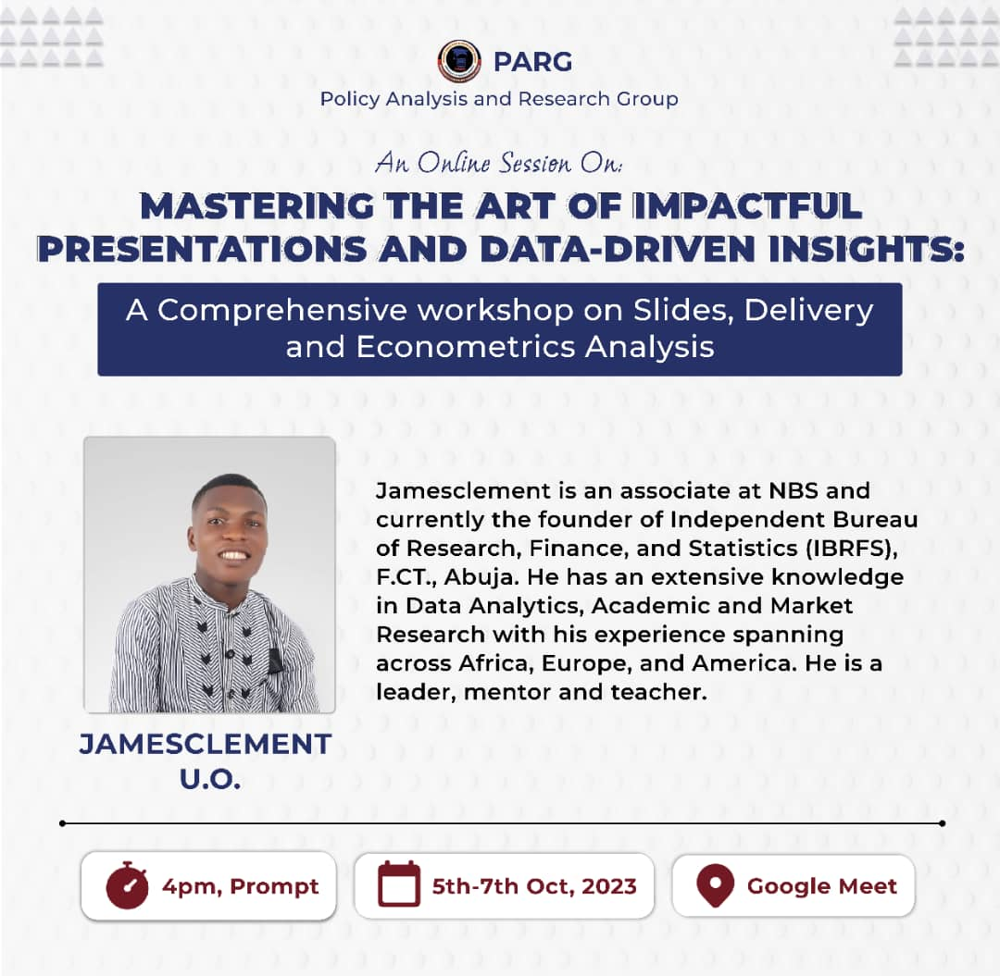

Jamesclement Onyekachi Ugwu was the guest technical facilitator at an online workshop organised by the Policy Analysis and Research Group (PARG), held on Google Meet from 5 to 7 October 2023. The workshop covered slide design, delivery and econometric analysis for data-driven presentations. Co-speakers were Christian Nwobodo (Founder, Saturday Business School) and Chidera Umelo (Department of Economics graduate).

